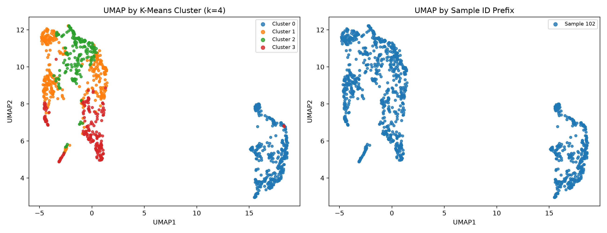

# glioma-data-separator

An end-to-end single-cell RNA-sequencing (scRNA-seq) analysis pipeline built in Python to process, reduce, cluster, and identify marker signatures in IDH-wildtype glioblastoma (GBM) patient cohorts from **GEO dataset GSE131928**.



---

## Overview

Glioblastoma exhibits substantial intratumoral and microenvironmental heterogeneity across patient populations. This pipeline ingests raw expression matrices (`1,152` cells across `30,314` genes), executes quality control filtering and variance stabilization, performs linear and non-linear dimensionality reduction, partitions cellular subpopulations via unsupervised clustering, and extracts differentially enriched transcriptional markers.

## Pipeline Architecture

All processing stages are modularized and orchestrated sequentially through `run_all.py`:

| Stage | Script | Key Operations & Parameters | Outputs |
| :--- | :--- | :--- | :--- |
| **1. QC & Normalization** | `prep_qc_and_log1p.py` | Filters cells ($\ge 200$ genes/cell) and genes ($\ge 3$ cells/gene) to `1,152` cells $\times$ `15,722` genes; applies $\log(1 + \text{TPM})$ transformation; selects top `2,000` highly variable genes (HVGs). | `qc_log1p_hvg_matrix.csv` |
| **2. Linear Reduction** | `run_pca.py` | Standardizes HVG expression (`StandardScaler`) and computes Principal Component Analysis (`PC1`: `11.34%`, `PC2`: `3.89%`, `20.02%` cumulative variance across top 10 PCs). | `pca_coordinates.csv`<br>`pca_explained_variance.csv` |
| **3. Embedding & Clustering** | `run_umap_cluster.py` | Embeds top `15` PCs into 2D space via UMAP and partitions cells into $k = 4$ transcriptional states using K-Means clustering. | `umap_clusters.csv`<br>`umap_clusters_vs_samples.png` |
| **4. Marker Discovery** | `find_markers.py` | Evaluates cluster-specific mean expression enrichment (`diff`) and detection percentages (`in` vs. `out`) to rank top transcriptional markers per cluster. | `top_cluster_markers.csv` |
| **Orchestrator** | `run_all.py` | Executes Stages 1–4 sequentially in a single reproducible command. | Full pipeline logs & artifacts |

---

## Key Biological Findings (`GSE131928`)

Unsupervised clustering of the `1,152` cells resolved four distinct transcriptional compartments:

* **Cluster 0 — Tumor-Associated Microglia / Macrophages:** Enriched for myeloid immune signatures (including *FCER1G*), capturing the resident and infiltrating immune microenvironment.
* **Cluster 1 (`n = 365`) — Neuronal / Neurodevelopmental-Like:** Strong enrichment for *STMN2* (`+3.940`), *SOX4* (`+3.798`), *STMN4* (`+3.642`), *NOVA1* (`+3.368`), and *TUBB2B* (`+3.269`).
* **Cluster 2 (`n = 205`) — Shared Neural / Proliferative Transition:** Co-expresses cytoskeletal and neural progenitor transcripts including *TUBB2B* (`+2.456`), *SOX4* (`+2.384`), *MARCKSL1* (`+2.345`), *TUBA1A* (`+1.763`), and *STMN1* (`+1.741`).
* **Cluster 3 (`n = 221`) — Glial / Oligodendrocyte Progenitor-Like (OPC-Like):** Characterized by canonical oligodendrocyte-lineage markers *BCAN* (`+4.703`), *GPM6B* (`+4.121`), *APOD* (`+4.043`), *OLIG1* (`+3.934`), and *PTPRZ1* (`+3.787`).

---

## Repository Contents

```text
glioma-data-separator/
├── run_all.py                    # End-to-end pipeline runner
├── prep_qc_and_log1p.py          # Quality control, log1p normalization, and HVG selection
├── run_pca.py                    # Feature scaling and Principal Component Analysis
├── run_umap_cluster.py           # UMAP embedding, K-Means clustering, and visualization
├── find_markers.py               # Differential cluster marker ranking
├── pca_explained_variance.csv    # Summary table of variance explained per PC
├── top_cluster_markers.csv       # Top enriched marker genes across Clusters 0–3
├── umap_clusters_vs_samples.png  # 2D UMAP projection comparing clusters and sample cohorts
├── LICENSE
└── README.md
## Quickstart

1. Install dependencies:
```bash
pip install -r requirements.txt
